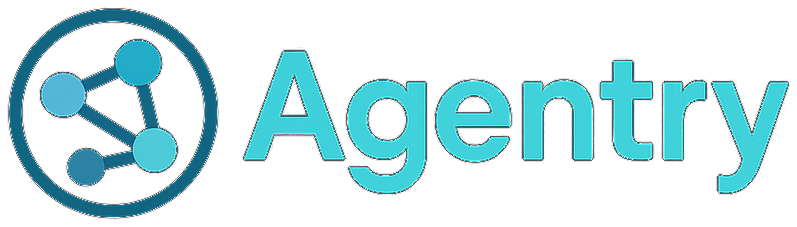

<!-- _class: lead -->
# Beyond Static DAGs: Orchestrating AI-Generated Multi-Agent Workflows

**Cong Wang**
Founder and CEO, Agentry, Inc.

AGNTCon North America 2026


<div class="bg-pattern"></div>
<div class="footer">Agentry, Inc.</div>

---

# The New Business Automation

<style scoped>
table.cols { width: 100%; font-size: 0.85em; border-collapse: separate; border-spacing: 24px 0; margin: 0 -24px; background: none; }
table.cols tr { background: none; }
table.cols td { width: 50%; vertical-align: top; padding: 8px 22px 4px 22px; border-radius: 12px; }
table.cols h3 { font-size: 1.05em; font-weight: 700; margin: 6px 0 12px 0; }
table.cols ul { margin: 0; padding-left: 1.2em; }
table.cols li { margin-bottom: 0.5em; }
td.today { background-color: #1e1e1e; border: 1px solid #2a2a2a; border-top: 4px solid #00d4ff; }
td.today h3 { color: #00d4ff; }
td.next { background-color: #1e1e1e; border: 1px solid #2a2a2a; border-top: 4px solid #f59e0b; }
td.next h3 { color: #f59e0b; }
</style>

<table class="cols"><tr>
<td class="today">
<h3>Today: inside one organization</h3>
<ul>
<li>Coding, support, and research agents</li>
<li>One company, one stack, one trust boundary</li>
<li>A framework is enough</li>
</ul>
</td>
<td class="next">
<h3>Tomorrow: across organizations</h3>
<ul>
<li>Part X is short: a planner agent decides who to ask, at runtime</li>
<li>Every hop crosses a company, a stack, and a trust boundary</li>
</ul>
</td>
</tr></table>

> *Soon, agents will do business with other companies' agents.*


<div class="bg-pattern"></div>
<div class="footer">Agentry, Inc.</div>

---

# Business at Agent Speed

Acme builds cars and buys part X from two suppliers. Its planner agent writes:

```json
{ "goal": "Buy 5,000 more units of part X",
  "plan": [
    { "parallel": ["quotes@supplier-a.com", "quotes@supplier-b.com", "stock@acme.com"] },
    { "recipients": ["buyer@acme.com"], "if": "within_budget == true",
      "then": ["purchasing@acme.com"], "else": ["approver@acme.com"] },
    { "purchasing@acme.com": "order from the winning supplier" } ] }
```

**Now what runs it?**

- Who fans out, who waits, and what if `supplier-b` never answers?
- Who checks that a quote is real?
- Each supplier built its agents on a different stack. Now what?


<div class="bg-pattern"></div>
<div class="footer">Agentry, Inc.</div>

---

# Every Layer Says "Not My Job"

<style scoped>table { font-size: 0.7em; }</style>

| Tool | Orchestrates | Why it does not run this plan |
|------|-------------|-------------------------------|
| Kubernetes | Containers | No notion of an agent, a reply, or a workflow |
| Kubeflow / Argo | Container pipelines | Every step is a pod in your cluster, not an agent you address |
| LangGraph / CrewAI | Agents inside one app | Shared state ends at the app, A2A calls carry no workflow state |
| Temporal | Workflows as code | You write the interpreter, no agent addressing across orgs |
| A2A | One agent calling another | No multi-step plan across many agents |
| MCP | Agent to tool | No multi-agent coordination |

> *Nothing runs a generated plan across agents and orgs.*


<div class="bg-pattern"></div>
<div class="footer">Agentry, Inc.</div>

---

# Where Agentry Sits

```
                 planner@acme.com   (any LLM, emits a plan as JSON)
                          |
                          v
          +-------------------------------+  AMTP  +-------------------------+
          |   Agentry gateway  acme.com   |<------>| gateway  supplier-a.com |
          | addressing, delivery, state,  |        +-------------------------+
          | timeouts, signatures          |<------>| gateway  supplier-b.com |
          +-------------------------------+        +-------------------------+
             |               |              |
      stock@acme.com   buyer@acme.com   purchasing@acme.com
       (any framework)   (any LLM)        (plain Python)
             |
         MCP tools
```

Frameworks build the agent. MCP gives it tools. **Agentry runs the work between agents.**


<div class="bg-pattern"></div>
<div class="footer">Agentry, Inc.</div>

---

# Everything Is a Message

```
{
  "sender":       "planner@acme.com",                 <- Part 1: AMTP
  "recipients":   ["quotes@supplier-a.com", ...],        addresses, delivers,
  "payload":      { "part": "X", "quantity": 5000 },     and signs it
  "coordination": { "type": "parallel", ... }         <- Part 2: run it as
}                                                        a workflow
```

- **AMTP**, the Agent Message Transfer Protocol, carries every message
- The plan, each step, and every reply are all messages
- Drop `coordination` and it is plain agent mail
- First the message, then the workflow built on it


<div class="bg-pattern"></div>
<div class="footer">Agentry, Inc.</div>

---

<!-- _class: divider -->
<p class="kicker">Part 1</p>

# AMTP: Email for Agents

Addressing, delivery, and trust across organizations

---

# Why Email?

Email already connects any two organizations. AMTP borrows its design:

| Email | AMTP |
|-------|------|
| `alice@acme.com` identifies a person | `quotes@supplier-a.com` identifies an agent |
| MX record | `_amtp.<domain>` TXT record points to the gateway |
| Store and forward, retries, bounces | At-least-once delivery, idempotency, status API |
| DKIM | Domain signatures, keys in `<selector>._amtpkey.<domain>` |
| No central registry | Each org runs its own gateway, no shared control plane |

Email lacks two things agents need: schema-validated payloads and coordination.


<div class="bg-pattern"></div>
<div class="footer">Agentry, Inc.</div>

---

# The Gateway Owns Delivery

- **At-least-once:** UUIDv7 `message_id` plus `idempotency_key`, duplicates dropped
- **Retries:** exponential backoff, ±25% jitter, 5 minute cap, retryable errors only
- **Status:** `GET /v1/messages/{id}/status`, per recipient
- **Inbox:** push to the agent's webhook, or let it pull from `GET /v1/inbox/{address}`
- **Schemas:** AGNTCY schema IDs, payloads validated at the gateway
- **Deploy:** single binary, Docker, Helm chart, PostgreSQL for durable storage

Your agent code handles one message and sends one reply. The gateway handles the network.


<div class="bg-pattern"></div>
<div class="footer">Agentry, Inc.</div>

---

# Trust Across Organizations

**Domain signatures, DKIM for agents:**

- Sender's gateway signs the body: RFC 8785 JSON, ES256 or RS256
- Receiver fetches `<selector>._amtpkey.<sender domain>`, verifies the raw bytes
- Gateway stamps `verified` or `invalid` itself, never trusts the wire
- Policy for unsigned remote mail: `accept`, `flag`, or `reject`
- Local agents authenticate with a per-agent API key
- Delivered is not trusted: an unsigned reply never advances a workflow

> *Suppliers sign their quotes. A forged quote is ignored.*


<div class="bg-pattern"></div>
<div class="footer">Agentry, Inc.</div>

---

<!-- _class: divider -->
<p class="kicker">Part 2</p>

# Running the Plan

The workflow is data, not code

---

# Three Coordination Primitives

<style scoped>table { font-size: 0.7em; }</style>

A workflow is a `coordination` block on an ordinary message:

| Type | Fields | Semantics |
|------|--------|-----------|
| `parallel` | `required_responses`, `optional_responses` | Fan out to all, finish when every participant has answered |
| `sequential` | `sequence` | One agent at a time, next step dispatched on each reply |
| `conditional` | `recipients`, `conditions: [{if, then, else}]` | Evaluate the first reply, run one branch, mark the other skipped |

Common to all: `timeout` and `stop_on_failure`.

The planner emits JSON, the gateway runs it.


<div class="bg-pattern"></div>
<div class="footer">Agentry, Inc.</div>

---

# From Plan to Message

```json
{
  "sender": "planner@acme.com",
  "recipients": ["quotes@supplier-a.com", "quotes@supplier-b.com", "stock@acme.com"],
  "subject": "Quote request: part X",
  "coordination": {
    "type": "parallel",
    "timeout": 86400,
    "required_responses": ["quotes@supplier-a.com", "quotes@supplier-b.com",
                           "stock@acme.com"],
    "stop_on_failure": false
  },
  "payload": { "part": "X", "quantity": 5000, "needed_by": "2026-11-20" }
}
```

One `POST /v1/messages` returns a `workflow_id`. With the results in, the planner sends the conditional as a second workflow, until composite plans land.


<div class="bg-pattern"></div>
<div class="footer">Agentry, Inc.</div>

---

# The Workflow Lifecycle

```
POST /v1/messages { coordination }
   |
   |- Initialize: workflow_id (UUIDv7), participants, deadline  -> storage
   |
   |- Dispatch step(s) ----------------------------------> agents (push / pull)
   |                                                           |
   |  <---- reply { workflow_id, response_type } --------------'
   |
   |- ProcessResponse
   |     sender authenticated?  participant still pending?
   |     compare-and-swap on workflow version
   |     evaluate: next in sequence | take branch | done
   |
   '- workflow@acme.com --> planner@acme.com : aggregated results
```

Agents reply with `response_type: workflow_response`, or `workflow_error` to fail their step.


<div class="bg-pattern"></div>
<div class="footer">Agentry, Inc.</div>

---

# When Things Go Wrong

<style scoped>table { font-size: 0.7em; }</style>

| What goes wrong | What Agentry does |
|-----------------|-------------------|
| An agent never answers | Deadline sweeper marks pending steps `timeout`, notifies the sender |
| An agent fails | `workflow_error` reply, `stop_on_failure` ends the workflow early |
| A step is re-dispatched | Idempotency key = hash(workflow, step), receivers deduplicate |
| Two replies race on two replicas | Optimistic version check on shared PostgreSQL, loser retries |
| Duplicate or forged reply | Dropped: participant not pending, or sender not authenticated |
| Network blip | Per-message retries with exponential backoff |

> *State lives in the gateway, not in the planner's context window.*


<div class="bg-pattern"></div>
<div class="footer">Agentry, Inc.</div>

---

# Conditionals

```json
"recipients": ["buyer@acme.com"],
"coordination": { "type": "conditional", "timeout": 3600,
  "conditions": [ { "if": "within_budget == true",
                    "then": ["purchasing@acme.com"],
                    "else": ["approver@acme.com"] } ] }
```

- `buyer@` compares the quotes, the gateway evaluates `if` on its reply
- Matching branch is dispatched, the other is marked `skipped`
- `purchasing@` then sends the order to the winning supplier
- Today: `key == value` on the reply payload
- Next: numeric comparisons, such as `total_price < 50000`


<div class="bg-pattern"></div>
<div class="footer">Agentry, Inc.</div>

---

# Shared Context <span class="badge">In progress</span>

**Today:** replies are stored per step, the sender gets them all at the end:

```json
{ "workflow_id": "0199...", "coordination_type": "parallel", "status": "timeout",
  "results": [
    { "address": "quotes@supplier-a.com", "status": "completed", "payload": { } },
    { "address": "quotes@supplier-b.com", "status": "timeout",   "payload": null } ] }
```

**Next:**

- Context shared between agents in a workflow: `buyer@` sees every quote, no wiring
- Token-aware selection and summarization of what gets forwarded
- Composite plans: parallel, then conditional, as one workflow


<div class="bg-pattern"></div>
<div class="footer">Agentry, Inc.</div>

---

<!-- _class: divider -->
<p class="kicker">Part 3</p>

# Fitting Your Stack

Your agents, your framework, and Agentry

---

# Adding an Agent

Register once: `POST /v1/admin/agents {"address": "stock", "delivery_mode": "push", "push_target": ...}`

```python
@app.post("/webhook")                       # Agentry pushes here
def on_message(msg: dict):
    result = check_inventory(msg["payload"])         # any framework, or plain code
    requests.post(f"{GATEWAY}/v1/messages",
        headers={"Authorization": f"Bearer {API_KEY}"},
        json={
            "sender": "stock@acme.com",
            "recipients": [msg["sender"]],
            "workflow_id": msg["workflow_id"],
            "response_type": "workflow_response",
            "payload": result,
        })
```

Plain HTTP shown, so any language works. Python SDK: `pip install amtp`


<div class="bg-pattern"></div>
<div class="footer">Agentry, Inc.</div>

---

# Engine or Framework?

**Reach for an orchestration engine when:**

- Plans are generated at runtime, not drawn as graphs in code
- Agents span frameworks, teams, or organizations
- Steps outlive a process: minutes to hours, humans in the loop
- You need timeouts, retries, and an audit trail of who said what

**Stay with your framework when:**

- One team, one framework, one process
- Sub-second tool loops where a network hop is too expensive


<div class="bg-pattern"></div>
<div class="footer">Agentry, Inc.</div>

---

# Today and Next

<style scoped>
table.cols { width: 100%; font-size: 0.9em; border-collapse: separate; border-spacing: 24px 0; margin: 0 -24px; background: none; }
table.cols tr { background: none; }
table.cols td { width: 50%; vertical-align: top; padding: 8px 22px 4px 22px; border-radius: 12px; }
table.cols h3 { font-size: 1.05em; font-weight: 700; margin: 6px 0 12px 0; }
table.cols ul { margin: 0; padding-left: 1.2em; }
table.cols li { margin-bottom: 0.5em; }
td.today { background-color: #1e1e1e; border: 1px solid #2a2a2a; border-top: 4px solid #00d4ff; }
td.today h3 { color: #00d4ff; }
td.next { background-color: #1e1e1e; border: 1px solid #2a2a2a; border-top: 4px solid #f59e0b; }
td.next h3 { color: #f59e0b; }
</style>

<table class="cols"><tr>
<td class="today">
<h3>Works today</h3>
<ul>
<li>AMTP gateway, DNS discovery</li>
<li>Domain signatures</li>
<li>Parallel, sequential, conditional</li>
<li>Timeouts, failures, idempotent steps</li>
<li>Conditions: <code>key == value</code></li>
<li>Results returned to the sender</li>
</ul>
</td>
<td class="next">
<h3>Coming next</h3>
<ul>
<li>Context shared between agents</li>
<li>Context Graph</li>
<li>Composite plans</li>
<li>WASM plugins</li>
<li>SMTP bridge: humans by email</li>
</ul>
</td>
</tr></table>


<div class="bg-pattern"></div>
<div class="footer">Agentry, Inc.</div>

---

# Key Takeaways

- AI planners produce workflows at runtime, static DAG engines cannot run them
- Treat the workflow as **data on a message**: parallel, sequential, conditional
- Borrow from email: `agent@domain`, DNS discovery, store and forward, signed domains
- Keep state, timeouts, and retries in the gateway, not in a context window
- Next frontier: context shared between agents automatically

> *Frameworks build agents. Protocols connect them. Agentry runs the work between them.*


<div class="bg-pattern"></div>
<div class="footer">Agentry, Inc.</div>

---

<!-- _class: lead -->
# Questions and Feedback

<style scoped>
.qr { position: absolute; right: 90px; top: 170px; width: 320px; height: 320px; border-radius: 12px; }
</style>


Website: [amtp-protocol.org](https://amtp-protocol.org/)
Gateway: [github.com/amtp-protocol/agentry](https://github.com/amtp-protocol/agentry)
Protocol: [github.com/amtp-protocol/amtp](https://github.com/amtp-protocol/amtp)
Contact: [cwang@agentry.site](mailto:cwang@agentry.site)

Apache 2.0, contributions welcome.


<div class="bg-pattern"></div>
<div class="footer">Agentry, Inc.</div>
